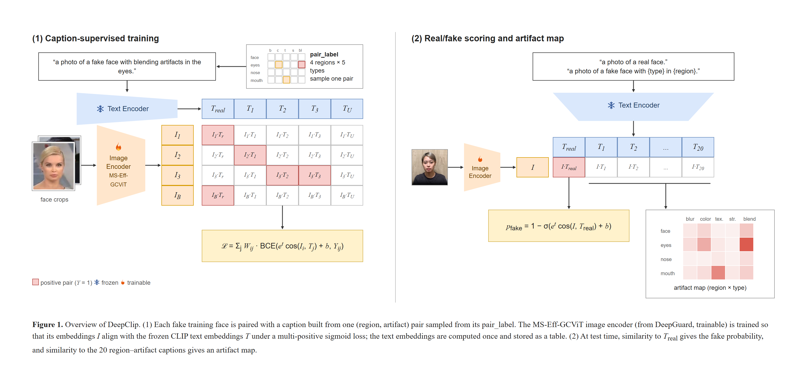

# DeepClip

<p align="center">
  
  
  
  
  
  
  <a href="https://huggingface.co/spaces/KoreaPeter/deepclip"></a>
</p>

<p align="center">
  <b>Region-Aware Face Forgery Artifact Description with Contrastive Language-Image Pre-training</b><br>
  <sub>4 face regions × 5 artifact types: not just <i>whether</i> a face is fake, but <i>where</i> and <i>how</i>.</sub>
</p>

<p align="center">
  
</p>


## 📌 Contents

- [💡 What DeepClip Predicts](#-what-deepclip-predicts) - Fake probability plus 20 artifact scores (4 face regions × 5 artifact types)
- [🏗️ Architecture](#-architecture) - DeepGuard's MS-Eff-GCViT image encoder aligned with frozen CLIP text embeddings
- [🧬 Model Zoo](#-model-zoo) - `deepclip_b0` and `deepclip_b5`
- [🤗 Try It Live: Hugging Face Spaces](#-try-it-live-hugging-face-spaces) - Upload an image or video to the Hugging Face Space, no install needed
- [🔮 Predict Image & Video](#-predict-image--video) - Detect deepfakes and their artifacts via the Hugging Face Hub or `deepclip.detect`
- [🚀 Training](#-training) - Train DeepClip with `train_deepclip.py` and W&B experiment tracking
- [📈 Model Evaluation](#-model-evaluation) - Benchmark a pretrained model on deepfake videos with `test_deepclip.py`
- [⚖️ License](#-license) - MIT license

## 💡 What DeepClip Predicts

DeepClip scores a face image against CLIP text captions. Besides the **fake probability**, it gives an
**artifact score** for each pair of a face region and a forgery artifact type, so you can see *where* and *what kind of*
forgery the model sees.

| | Values |
| --- | --- |
| **Region** | `face`, `eyes`, `nose`, `mouth` |
| **Artifact type** | `blur`, `color`, `texture`, `structure`, `blend` |

- **Fake probability**: `1 - p_real`, where `p_real` is the score of the caption *"a photo of a real face."*
- **Artifact scores**: 4 regions × 5 types = 20 captions such as *"... blending artifacts on the mouth"*, each a probability in `[0, 1]`.

## 🏗️ Architecture

DeepClip combines the **MS-Eff-GCViT** image encoder of [DeepGuard](https://github.com/HanMoonSub/DeepGuard) with the
text encoder of **CLIP**.

- **(1) Training**: every fake face gets a caption built from one (region, artifact type) pair sampled from its
  `pair_label`. The image encoder (trainable) is aligned with the frozen CLIP text embeddings with a multi-positive
  sigmoid loss (SigLIP). The 21 caption embeddings are computed once and kept in a table, so the text encoder is not
  run during training.
- **(2) Inference**: the similarity to *"a photo of a real face."* gives the fake probability, and the similarity to
  the 20 region–artifact captions gives the artifact map.

## 🧬 Model Zoo

| Model | Resolution | Image Encoder | Text Encoder | Params | FLOPs | Model Config |
| ----- | ---------- | ------------- | ------------ | ------ | ----- | ------------ |
| ⚡ deepclip_b0 | 224 X 224 | ms_eff_gcvit_b0 | CLIP ViT-B/16 (frozen) | 8.82M | 0.83G | [spec](deepclip/config/deepclip_b0.yaml) |
| 🔥 deepclip_b5 | 384 X 384 | ms_eff_gcvit_b5 | CLIP ViT-L/14 (frozen) | 50.61M | 13.26G | [spec](deepclip/config/deepclip_b5.yaml) |

## 🤗 Try It Live: Hugging Face Spaces

Try DeepClip in the browser on [**Hugging Face Spaces**](https://huggingface.co/spaces/KoreaPeter/deepclip), with no
install needed.

<table align="center">
  <tr>
    <td align="center">
      <div>📝</div>
      <b>Face Forgery Artifact Description</b>
      <br/>
      <sub>Upload an image or video → fake probability + region × artifact captions in text</sub>
      <br/><br/>
      <table cellpadding="4" cellspacing="0" bgcolor="#000000"><tr><td>
        <a href="https://huggingface.co/spaces/KoreaPeter/deepclip">
          
        </a>
      </td></tr></table>
    </td>
  </tr>
</table>

<p align="center">
  <sub>💛 Enjoying the demos? Please leave a ❤️ like on the Space — it means a lot to us!</sub>
</p>

## 🔮 Predict Image & Video

Both options detect the largest face with YOLO (`yolov8n-face`, downloaded to `~/.cache/deepclip` on the first run),
crop it with a margin and run DeepClip on the crop.

### Option A: HuggingFace

The pretrained models are on the Hugging Face Hub as
[`KoreaPeter/deepclip_b0`](https://huggingface.co/KoreaPeter/deepclip_b0) and
[`KoreaPeter/deepclip_b5`](https://huggingface.co/KoreaPeter/deepclip_b5). The Hub code imports `deepclip`, so install
it together with `transformers`:

```bash
pip install "deepclip[detect]" transformers
```

> [!NOTE]
> The models are gated because they were trained on FaceForensics++. Accept the terms on the model page and log in
> with `hf auth login` before the first download.

```python
from transformers import pipeline

# 🖼 Image classification
clf = pipeline(
    "image-classification",
    model="KoreaPeter/deepclip_b0",  # or KoreaPeter/deepclip_b5
    trust_remote_code=True,
)
result = clf("face.jpg")
# [{'label': 'fake', 'score': 0.9712}, {'label': 'real', 'score': 0.0288}]

result = clf("face.jpg", return_artifacts=True)
# [..., {'artifacts': {'face': {'blur': 0.12, ...}, 'eyes': {...}, 'nose': {...}, 'mouth': {...}}}]

# 🎬 Video classification
clf = pipeline(
    "video-classification",
    model="KoreaPeter/deepclip_b0",
    trust_remote_code=True,
)
result = clf("video.mp4", num_frames=20, agg_mode="conf", return_artifacts=True)
# [{'label': 'fake', 'score': 0.9634}, {'label': 'real', 'score': 0.0366}, {'artifacts': {...}}]
```

| Argument | Pipeline | Description |
| -------- | -------- | ----------- |
| `margin_ratio`, `conf_thres`, `min_face_ratio`, `tta_hflip` | both | Same as Option B |
| `return_artifacts` | both | Append the 20 artifact scores (mean over the frames for videos) |
| `num_frames`, `agg_mode` | video | Same as Option B |
| `return_frame_scores` | video | Append the fake probability of every sampled frame |

When no face is found, both pipelines return `[{'label': 'no_face_detected', 'score': -1.0}]`.

### Option B: Pip

```bash
pip install "deepclip[detect]"
```

The `detect` extra installs [`ultralytics`](https://github.com/ultralytics/ultralytics) for the YOLO face detection
used by `deepclip.detect`. If you only need the models (`timm.create_model("deepclip_b0", pretrained=True)`),
`pip install deepclip` is enough.

> [!NOTE]
> Importing `deepclip.detect` without the extra raises an error that tells you to run `pip install "deepclip[detect]"`.

#### Predict DeepFake Image

```python
from deepclip.detect import ClipImagePredictor

# Initialize the predictor
predictor = ClipImagePredictor(
            margin_ratio = 0.2, # Margin ratio around the detected face crop
            conf_thres = 0.5, # Confidence threshold for face detection
            min_face_ratio = 0.01, # Minimum face-to-frame size ratio to process
            model_name = "deepclip_b0", # deepclip_b0, deepclip_b5
            )

# Fake probability only
prob = predictor.predict_img(
            img_path = "path/to/image.jpg",
            tta_hflip = 0.0 # Horizontal Flip for Test-Time Augmentation
            )
print(f"Deepfake Probability: {prob:.4f}")

# Fake probability + artifact scores
result = predictor.predict_img_artifacts(img_path = "path/to/image.jpg")
print(result["prob"])                       # fake probability
print(result["artifacts"]["mouth"]["blend"]) # blending artifacts on the mouth
```

#### Predict DeepFake Video

```python
from deepclip.detect import ClipVideoPredictor

# Initialize the predictor
predictor = ClipVideoPredictor(
            margin_ratio = 0.2, # Margin ratio around the detected face crop
            conf_thres = 0.5, # Confidence threshold for face detection
            min_face_ratio = 0.01, # Minimum face-to-frame size ratio to process
            model_name = "deepclip_b0", # deepclip_b0, deepclip_b5
            )

# Fake probability only
prob = predictor.predict_video(
            video_path = "path/to/video.mp4",
            num_frames = 20, # Number of frames to sample per video
            agg_mode = "conf", # Aggregation Method: 'conf', 'mean', 'vote'
            tta_hflip = 0.0 # Horizontal Flip for Test-Time Augmentation
            )
print(f"Deepfake Probability: {prob:.4f}")

# Fake probability + artifact scores (mean over the frames)
result = predictor.predict_video_artifacts(video_path = "path/to/video.mp4", num_frames = 20)
```

**Output of `predict_*_artifacts`**

```python
{
    "prob": 0.9634,               # fake probability (aggregated with agg_mode for videos)
    "artifacts": {                # None when no face is found (prob is 0.5)
        "face":  {"blur": 0.12, "color": 0.08, "texture": 0.21, "structure": 0.05, "blend": 0.64},
        "eyes":  {...},
        "nose":  {...},
        "mouth": {...},
    },
}
```

| `agg_mode` | Frame Aggregation |
| ---------- | ----------------- |
| `conf` | Mean of the confident frames (> 0.8 or < 0.2) when enough frames agree, otherwise mean |
| `mean` | Mean of all frames |
| `vote` | Ratio of frames with probability > 0.5 |

## 🚀 Training

`train_deepclip.py` and `test_deepclip.py` run against the full repo, not the pip package.
Clone it and install the full dev environment:

```bash
git clone https://github.com/SEOYUNJE/DeepClip.git
cd DeepClip
pip install -r requirements.txt
```

DeepClip is trained on the frame-level FaceForensics++ dataset with its forgery annotation.
We recommend **Weights & Biases (W&B)** for experiment tracking (`--wandb-api-key` is required).

```python
!python train_deepclip.py \
    --root-dir DATA_ROOT \
    --model-name "deepclip_b0" \ # deepclip_b0, deepclip_b5
    --output-dir "checkpoints" \ # Directory of the best checkpoint
    --seed 2025 \ # for reproducibility
    --wandb-api-key "your-api-key" # Write your own api key
```

`DATA_ROOT` must contain the frame metadata and the face crops:

```Plaintext
DATA_ROOT/
├── crops/
│   └── {vid}/
│       ├── 12.png
│       └── ...
└── train_clip_frame_metadata.csv   # vid, frame_idx, label (REAL/FAKE), ori_vid, pair_label
```

`pair_label` is a string of 20 `0`/`1` characters, one per (region, type) pair in the order
`face-blur, face-color, ..., mouth-blend` (index = 5 × region + type).

| Argument | Default | Description |
| -------- | ------- | ----------- |
| `--root-dir` | (required) | Root directory of the dataset |
| `--model-name` | `deepclip_b0` | `deepclip_b0` or `deepclip_b5` |
| `--config` | `deepclip/config/deepclip_{b0,b5}.yaml` | Training recipe (model, text sampling, loss, optimizer) |
| `--output-dir` | `.` | Directory of the best checkpoint |
| `--seed` | `2025` | Random seed |
| `--num-workers` | `cpu_count - 1` | DataLoader workers |
| `--debug` | off | Train on a small subset |
| `--wandb-api-key` | (required) | W&B API key |
| `--metadata` | `train_clip_frame_metadata.csv` | Metadata file under `--root-dir` |
| `--crop-dir` | `crops` | Face crop directory under `--root-dir` |

## 📈 Model Evaluation

`test_deepclip.py` evaluates a pretrained DeepClip model on deepfake videos and prints AUC, accuracy, log loss,
macro F1, the confusion matrix and per-class precision / recall / F1. Run it from the cloned repo
(see [🚀 Training](#-training)).

```python
!python test_deepclip.py \
    --root-dir DATA_ROOT \
    --dataset "celeb_df_v2" \ # celeb_df_v2, ff++, kodf
    --model-name "deepclip_b0" \ # deepclip_b0, deepclip_b5
    --margin-ratio 0.2 \
    --conf-thres 0.5 \
    --min-face-ratio 0.01 \
    --num-frames 20 \
    --agg-mode "conf" \ # conf, mean, vote
    --tta-hflip 0.0 \
    --top-k 3 # Number of top artifact scores used by the rule-based fake probability (1-20)
```

The final fake probability of a video is rule-based: `max(prob, S_art)`, where `S_art` is the sigmoid of the mean
of the top-k artifact logits. Artifacts can only raise the fake probability, never lower it.

Both models are trained on FaceForensics++ only.

### In-Domain Evaluation

Tested on the FaceForensics++ test set.

| Model | Test@AUC | Test@Accuracy | Test@Log Loss | Test@Macro F1 |
| ----- | -------- | ------------- | ------------- | ------------- |
| ⚡ deepclip_b0 | 0.9917 | 96.33% | 0.0959 | 0.9396 |
| 🔥 deepclip_b5 | **0.9935** | **98.08%** | **0.0739** | **0.9672** |

### Cross-Domain Evaluation

Tested on datasets not seen during training.

**Celeb-DF (v2)**

| Model | Test@AUC | Test@Accuracy | Test@Log Loss | Test@Macro F1 |
| ----- | -------- | ------------- | ------------- | ------------- |
| ⚡ deepclip_b0 | 0.6821 | 61.97% | 0.8823 | 0.6147 |
| 🔥 deepclip_b5 | **0.7674** | **74.13%** | **0.7455** | **0.7162** |

**KoDF**

| Model | Test@AUC | Test@Accuracy | Test@Log Loss | Test@Macro F1 |
| ----- | -------- | ------------- | ------------- | ------------- |
| ⚡ deepclip_b0 | 0.7726 | 68.83% | **1.5238** | 0.6791 |
| 🔥 deepclip_b5 | **0.8277** | **71.75%** | 1.6868 | **0.7072** |

## ⚖️ License

This project is licensed under the terms of the MIT license.
